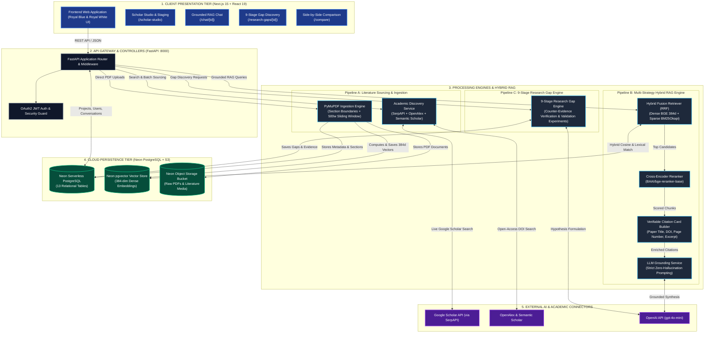
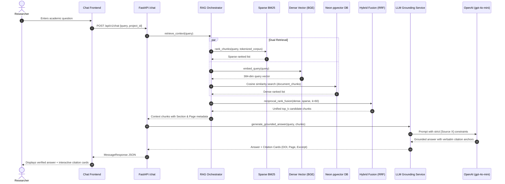
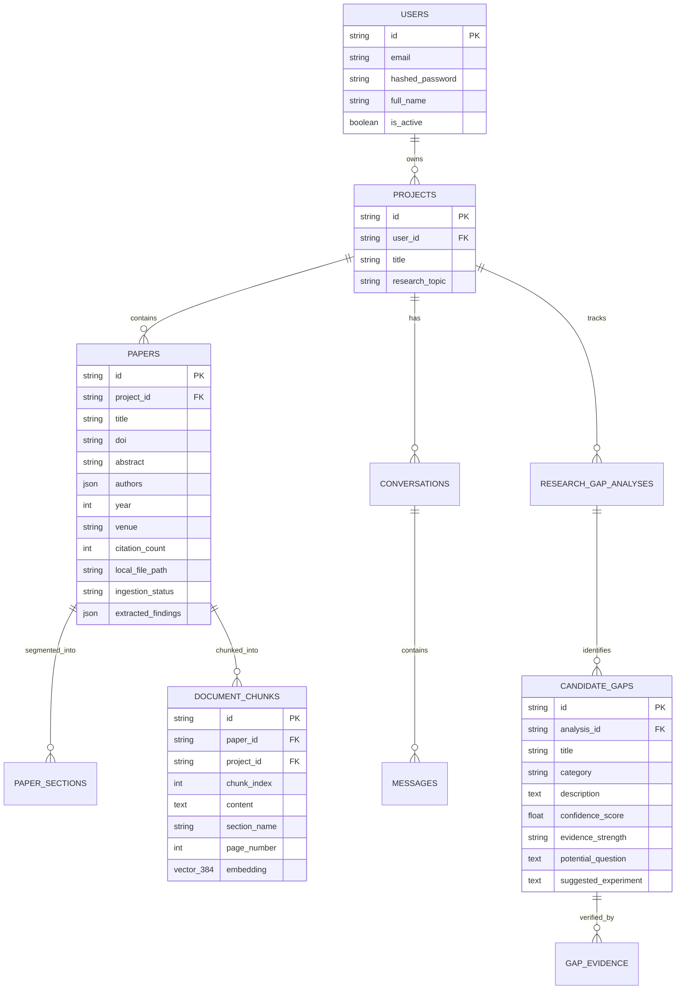

# System Architecture: AI Research Paper & Research Gap Finder

An enterprise-grade, end-to-end AI platform designed for PhD scholars, academics, and research teams to discover academic papers, ingest PDFs with section-aware RAG indexing, conduct grounded Q&A with verifiable page-level citations, compare papers side-by-side, and analyze novel research gaps with counter-evidence validation.

---

## 1. High-Level System Architecture

---

## 2. Layer-by-Layer Architectural Decomposition

### Tier 1: Frontend Client (Next.js 15, React 19, Tailwind CSS)
* **Framework:** Next.js 15 App Router with React 19 Server/Client Components.
* **Design Aesthetic:** Royal Blue (`#0F172A`, `#1E3A8A`, `#2563EB`) & Royal White (`#FFFFFF`, `#FAFAFC`) glassmorphic UI.
* **Core Views:**
  1. [`/scholar-studio`](file:///d:/minor3.0/frontend/src/app/scholar-studio/page.tsx): Live Google Scholar sourcing, interactive staging, checkbox verification, and batch RAG vector indexing.
  2. [`/papers`](file:///d:/minor3.0/frontend/src/app/papers/page.tsx): Multi-source discovery across OpenAlex, SerpAPI, and Semantic Scholar.
  3. [`/workspace/[projectId]`](file:///d:/minor3.0/frontend/src/app/workspace/%5BprojectId%5D/page.tsx): Workspace dashboard, collection manager, custom PDF uploader, and interactive citation graph.
  4. [`/chat/[projectId]`](file:///d:/minor3.0/frontend/src/app/chat/%5BprojectId%5D/page.tsx): Grounded conversation interface featuring expandable, verifiable citation cards.
  5. [`/research-gaps/[projectId]`](file:///d:/minor3.0/frontend/src/app/research-gaps/%5BprojectId%5D/page.tsx): Interactive 9-stage research gap review with counter-evidence badges and suggested experiment designs.
  6. [`/compare`](file:///d:/minor3.0/frontend/src/app/compare/page.tsx): Side-by-side comparison matrix of datasets, methods, metrics, and limitations.
  7. [`/trends/[projectId]`](file:///d:/minor3.0/frontend/src/app/trends/%5BprojectId%5D/page.tsx): Bibliometric momentum and publication velocity over time.

---

### Tier 2: Backend API & Gateway (FastAPI, Python 3.12, Uvicorn)
* **Framework:** FastAPI with asynchronous endpoints, Pydantic v2 schemas, and dependency injection.
* **Authentication:** OAuth2 password flow with JWT Bearer tokens and bcrypt password hashing.
* **Auto-Documentation:** OpenAPI 3.0 / Swagger accessible at `http://localhost:8000/docs`.

---

### Tier 3: Ingestion & Document Parsing Pipeline
* **Engine:** PyMuPDF (`fitz`) for PDF stream processing and text rendering.
* **Heading Heuristics:** Scans for structural academic headings using regular expressions:
  - `Abstract`, `Introduction`, `Methodology`, `Results`, `Discussion`, `Limitations`, `Future Work`, `Conclusion`, `References`.
* **Sliding Window Chunking:** 500-word passages with a 100-word overlap. Chunks preserve:
  - Page number (1-indexed)
  - Section category
  - Parent paper DOI and Title

---

### Tier 4: Multi-Strategy Hybrid RAG Engine

* **Sparse Retrieval:** `BM25Okapi` catches exact dataset names, algorithms, and author surnames.
* **Dense Retrieval:** `BAAI/bge-small-en-v1.5` embeds query and document chunks into 384-dimensional vectors.
* **Hybrid Fusion:** Reciprocal Rank Fusion:
  $$RRF\_Score(d) = \sum_{m \in \{\text{dense}, \text{sparse}\}} \frac{1}{60 + \text{rank}_m(d)}$$
* **Reranking:** Cross-Encoder `BAAI/bge-reranker-base` scores candidate pairs.
* **Zero-Hallucination Grounding:** Restricts LLM answers to retrieved chunks. Absence of evidence triggers explicit notification: *"Insufficient evidence found in the indexed paper collection."*

---

### Tier 5: 9-Stage Research Gap Analysis Engine
1. **Scope Definition:** Pinpoints the domain and selected paper corpus.
2. **Corpus Extraction:** Focuses extraction on *Limitations*, *Discussion*, and *Future Work* sections.
3. **Taxonomy Classification:** Categorizes candidates into:
   - *Generalization Weaknesses* (e.g. untested under domain shift)
   - *Inadequate Baseline Comparisons* (e.g. omitting PEFT/LoRA in LLM benchmarks)
   - *Reproducibility Limitations* (e.g. proprietary datasets without public release)
   - *Methodological Constraints*
4. **Counter-Evidence Verification:** Cross-verifies candidates against newer publications to eliminate solved problems.
5. **Hypothesis Formulation:** Produces concrete *Proposed Research Questions* and *Validation Experiment Protocols*.

---

### Tier 6: Cloud Infrastructure (Neon PostgreSQL + S3 Storage)

* **Neon Serverless PostgreSQL:** Hosts all relational entities with automatic connection pooling (`pool_pre_ping=True`).
* **`pgvector` Extension:** Stores 384-dimensional dense vectors directly in `document_chunks`.
* **Neon Object Storage (S3 / Tigris):** Stores raw PDF files and extracted media via `boto3`.

---

## 3. Technology Stack Reference

| Layer | Component | Technology Selected |
| :--- | :--- | :--- |
| **Frontend UI** | Application Framework | Next.js 15 (App Router), React 19 |
| | Styling & Animation | Tailwind CSS v3, Framer Motion |
| | State & Query Management | Zustand, TanStack React Query v5 |
| | Icons & Graphics | Lucide React |
| **Backend API** | Web Framework | FastAPI, Uvicorn, Python 3.12 |
| | Validation & Settings | Pydantic v2, Pydantic-Settings |
| | PDF Extraction | PyMuPDF (`fitz`) |
| **AI & RAG** | Vector Embeddings | `BAAI/bge-small-en-v1.5` (Sentence-Transformers) |
| | Lexical Retrieval | `rank_bm25` (BM25Okapi) |
| | Reranking Engine | `BAAI/bge-reranker-base` (Cross-Encoder) |
| | Generative LLM | OpenAI `gpt-4o-mini` (with offline fallback) |
| **Persistence** | Database | Neon Serverless PostgreSQL |
| | Vector Engine | `pgvector` PostgreSQL Extension |
| | ORM | SQLAlchemy 2.0 |
| | Media & PDF Storage | Neon S3 Object Storage (`boto3`) |
| **External Connectors** | Academic Search | SerpAPI (Google Scholar), OpenAlex, Semantic Scholar |
